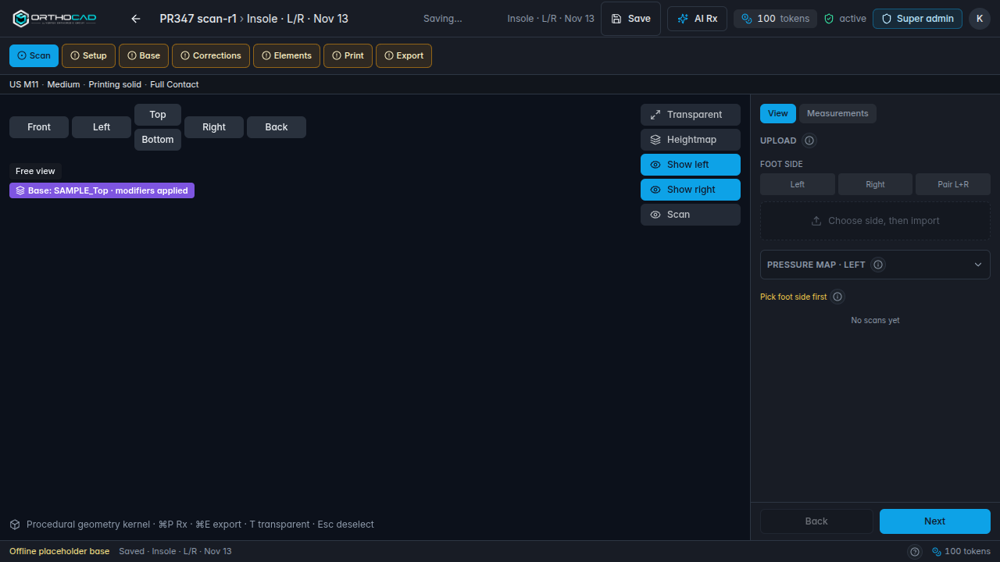
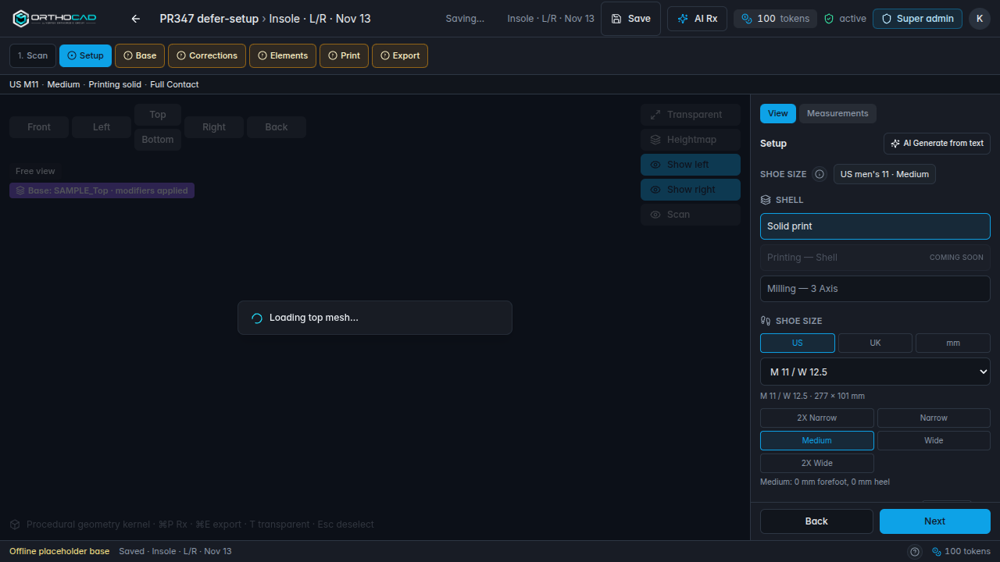

# PR #347 start-path & top-mesh load timing (2026-11-13)

**Branch under test:** `cursor/start-path-step-routing-and-lazy-top-glb-load-29b0`  
**Playwright:** headless Chromium, SwiftShader (`--use-gl=angle`, `--use-angle=swiftshader`)  
**Local app:** `http://localhost:5180` (Vite offline dev, `?e2eLogin=1`, no Supabase)  
**Vercel preview:** unreachable without Vercel SSO (302 → login).  
**Production:** `https://orthocad.vertexorthopedic.com` — automated login with dev credentials failed; no prod timings.  
**Baseline:** local `origin/main` on `http://localhost:5182` (one cold template run; see caveats below).

Raw machine metrics: [`pr347/timing-results.json`](./pr347/timing-results.json).

---

## Pass / fail summary

| Case | Result | Notes |
|------|--------|--------|
| 1 — New design from **3D scan** opens on **Scan**; no SAMPLE_Top **network** fetch on Scan; no **“Loading top mesh…”** on Scan | **Partial fail** | Scan step and zero GLB requests on Scan: **pass**. No loading splash on Scan: **pass**. Viewer still shows **“Base: SAMPLE_Top · modifiers applied”** on Scan (see screenshot). |
| 1b — Top mesh loads only after navigating to **Setup** | **Pass** | Network on Scan: `[]`; after clicking Setup, `SAMPLE_Top.glb` loads and splash appears (see `scan-after-setup-click.png`). |
| 2 — **Template** skips Scan, lands **Setup**, mesh loads immediately | **Pass** | Rail: Setup active; optional Scan dashed. Cold fetch: `/Templates/SAMPLE_Top.glb` (277,032 bytes). |
| 2 — **AI** skips Scan, lands **Setup**, mesh loads immediately | **Pass** | Rail: **Setup** active (offline heuristic parse). |
| 3 — Reopen existing design keeps saved step | **Fail** | Left on **Corrections**, saved, reopened via client file → lands on **Scan** (see `reopen-existing-design.png`). |

---

## Expected vs observed (case 1 detail)

**Passing parts**

- `beginInsoleDesignSession("scan")` via `?entry=scan` opens the editor on **Scan** (step rail).
- `useBaseInsoleGeometry` defers work when `shouldDeferTopMeshLoad(designStartPath, clinicalStep)` is true (`vertex/src/features/clients/start-path.ts`, `vertex/src/hooks/useBaseInsoleGeometry.ts` ~213–220): no GLB fetch recorded on Scan (3/3 runs).
- **“Loading top mesh…”** (`PrintLoftSplash` / `INITIAL_LOAD_LABEL`) was **not** visible on Scan in timed runs.

**Failing part**

- The viewport overlay **“Base: SAMPLE_Top · modifiers applied”** (`Viewer3D.tsx` base-mode chip) is still rendered on Scan for scan-started designs. The mesh load is deferred, but the label does not match Kendon’s “no … text while on Scan” criterion.

**Setup transition**

---

## Screenshots (opening step)

| Case | File |
|------|------|
| Scan (entry=scan) | `pr347/scan-run1-opening.png` |
| Template | `pr347/template-run1-opening.png` |
| AI | `pr347/ai-run1-opening.png` |
| Reopen (expected Corrections) | `pr347/reopen-existing-design.png` |

---

## Timing (ms from click → editor open through first paint / mesh ready)

Times are **median of 3 runs** unless noted. **Warm** runs reuse the same browser context (HTTP cache). **Cold** = first run in a new context.

### Template (`start-from-template` → Continue)

| Cache | First paint (Setup panel) | Top mesh ready * |
|-------|-------------------------|------------------|
| Cold (run 1) | 351 | 11,599 |
| Warm (runs 2–3) | 175 | 185 |
| **Median (all 3)** | **175** | **185** † |

\* “Mesh ready” = Setup panel visible, then no “Loading top mesh…” and `Base: SAMPLE_Top` label present.  
† Warm median dominated by cache; use **cold** for load cost.

**GLB (cold):** `http://localhost:5180/Templates/SAMPLE_Top.glb` — 277,032 bytes, HTTP 200.

### AI generate

| Cache | First paint (Setup) | Mesh ready |
|-------|---------------------|------------|
| Median (3× cold context) | 183 | 189 |

No additional GLB rows in warm runs (browser cache).

### Scan → open editor (`create-from-scan`)

| | First paint (Scan rail) |
|---|-------------------------|
| Median | **75** |

No GLB on Scan; mesh-ready N/A until Setup.

### PR branch vs local `main` (template, cold)

| | First paint | Mesh ready (cold) |
|---|-------------|-------------------|
| PR branch | 351 | 11,599 |
| `origin/main` @ 5182 | 162 | 165 ‡ |

‡ Main run did not record a GLB response in Playwright (possible faster stub path or race); treat comparison as **inconclusive** for “faster/slower” — not used for a prod claim.

---

## Code paths referenced

| Behavior | Location |
|----------|----------|
| `?entry=` → landing step + `designStartPath` | `EditorChrome.tsx` (`parseDesignEntryParam`, `beginInsoleDesignSession`) |
| Scan vs Setup landing | `start-path.ts` — `landingStepForStartPath`, `shouldDeferTopMeshLoad` |
| Defer SAMPLE_Top load on Scan | `useBaseInsoleGeometry.ts` effect guarded by `shouldDeferTopMeshLoad` |
| Start UI | `StartInsole.tsx` / `NewClientDialog.tsx` / `ClientFilePage.tsx` (`designPath(..., entry)`) |
| Reopen resets step | `EditorChrome.tsx` else branch sets `step: "scan"` when no `entry` param (explains case 3 **fail**) |
| “Loading top mesh…” | `preview-loft-ui.ts` → `PrintLoftSplash.tsx` |
| “Base: SAMPLE_Top …” chip | `Viewer3D.tsx` (always shown in procedural base mode) |

---

## Environment notes

- Preview URL from task redirects to Vercel team login; tests ran **only** on local PR branch (+ one `main` worktree).
- No secrets or PHI used; synthetic client names `PR347 …` / `Reopen final`.
- Playwright driver scripts used for this report are **not** committed (diagnostics-only).
